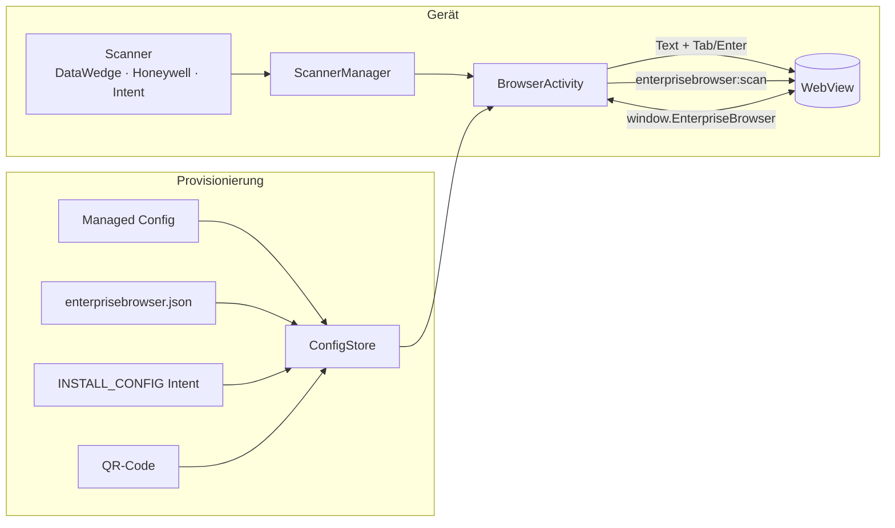

<p align="center">
  
</p>

<p align="center">
  
  
  
  
  
  
</p>

<p align="center">
  <b>Webanwendungen auf robusten Android-Geräten – mit Barcode-Scanner, Kiosk-Modus und zentraler Konfiguration.</b><br>
  Funktional angelehnt an den Web-Teil von Ivanti Velocity, als schlanke Neuimplementierung in Kotlin.
</p>

<p align="center">
  <a href="#-in-5-minuten-startklar">Schnellstart</a> ·
  <a href="docs/configuration.md">Konfiguration</a> ·
  <a href="docs/deployment.md">Verteilung (SOTI, Intune, StageNow)</a> ·
  <a href="docs/web-integration.md">Web-Integration</a> ·
  <a href="docs/velocity-migration.md">Umstieg von Velocity</a>
</p>

---

## ✨ So sieht es aus

<table>
  <tr>
    <td align="center"><br><sub><b>Profile</b><br>Ein Tipp öffnet die Web-App</sub></td>
    <td align="center"><br><sub><b>Scannen</b><br>Barcode landet im Feld + Enter</sub></td>
    <td align="center"><br><sub><b>Menü</b><br>Alles mit einem Daumen</sub></td>
    <td align="center"><br><sub><b>Einstellungen</b><br>Passwortgeschützt</sub></td>
  </tr>
</table>

## 🚀 Was es kann

| | |
|---|---|
| 📦 **Profile** | Start-URL, Host-Allowlist, User-Agent, Viewport, Farben – mehrere Web-Apps auf einem Gerät |
| 🔫 **Barcode-Scanner** | Zebra DataWedge, Honeywell, beliebige Scanner-Apps per Intent. Scan wird wie eine Tastatur ins Feld geschrieben (inkl. Tab/Enter) **und** als JS-Event gemeldet |
| 🧭 **Seitensteuerung** | Velocity-kompatible Meta-Tags `scanner` und `ScannerNavigate` |
| ⌨️ **Tastatur** | Bildschirmtastatur nur auf Knopfdruck, Hardware-Tasten umbelegen, Hotkeys, Makros wie `{F1}` `{TAB}` |
| 🧩 **Injections** | Eigenes CSS/JS/HTML in fremde Web-Apps einfügen – passend zur URL, ohne Flackern |
| 🔒 **Kiosk** | Toolbar/Systemleisten ausblenden, Beenden verbergen oder mit Passwort schützen, Lock Task per Device Owner |
| 📡 **Provisionierung** | Managed Configuration (SOTI, Intune, Workspace ONE …), Konfigurationsdatei, StageNow-Intent, QR-Code |
| 🎨 **Design anpassen** | Titel, Logo, Markenfarbe und Profilfarben – per Konfiguration oder direkt in der App |
| 🛡️ **Sicherheit** | Strenge TLS-Prüfung, Client-Zertifikate, Passwörter nur als PBKDF2-Hash, JS-Schnittstelle nur für freigegebene Hosts |

## ⚡ In 5 Minuten startklar

**1. App installieren** – APK aus den [Releases](../../releases/latest) laden und per MDM verteilen oder per USB installieren:

```bash
adb install -r EnterpriseBrowser-0.3.0.apk
```

**2. Konfiguration wählen** – fertige Vorlagen in [`examples/`](examples):

| Vorlage | Wofür |
|---|---|
| [`minimal.json`](examples/minimal.json) | Eine Web-App, startet automatisch |
| [`sap-its-mobile.json`](examples/sap-its-mobile.json) | SAP ITS mobile / MDE mit Scanner-Enter, Velocity-Viewport |
| [`kiosk-single-app.json`](examples/kiosk-single-app.json) | Vollständiger Kiosk ohne Ausweg (Passwörter anpassen!) |
| [`multi-profile-branding.json`](examples/multi-profile-branding.json) | Mehrere Apps mit eigenem Titel und Farben |
| [`injections-and-keys.json`](examples/injections-and-keys.json) | CSS/JS-Injection, Tastenbelegung, Scan-Hooks |

**3. Verteilen** – z. B. als Managed Configuration im MDM (Schlüssel `config_json`) oder als Datei
(App einmal starten, damit der Ordner existiert):

```bash
adb push examples/minimal.json /sdcard/Android/data/io.github.pieewiee.enterprisebrowser/files/enterprisebrowser.json
```

Alle Wege inkl. Schritt-für-Schritt für **SOTI MobiControl**: [Verteilung](docs/deployment.md).

**4. Testen** – das mitgelieferte Profil „Demo & Scanner-Test“ öffnen und scannen, oder ohne Scanner:

```bash
adb shell am broadcast -a io.github.pieewiee.enterprisebrowser.action.BARCODE \
  -p io.github.pieewiee.enterprisebrowser --es data 4006381333931 --es symbology EAN13
```

## 🎨 Design anpassen

Titel, Untertitel, Logo und Markenfarbe kommen aus der Konfiguration – oder werden direkt unter
**Einstellungen → Design** gesetzt. Jedes Profil kann zusätzlich eine eigene Farbe haben, die auch
die Toolbar in der Web-App einfärbt.

<p align="center">
  
</p>

```json
"global": {
  "branding": {
    "title": "Logistikzentrum Nord",
    "subtitle": "Schicht A · Halle 3",
    "color": "#00796B",
    "logo": "res:logo.png"
  }
}
```

<table>
  <tr>
    <td align="center"><br><sub>Markenfarbe in der App wählen</sub></td>
    <td align="center"><br><sub>Profil mit eigener Farbe</sub></td>
    <td align="center"><br><sub>Klare Fehlerseiten in Markenfarbe</sub></td>
  </tr>
</table>

Mehr dazu: [Konfiguration → Design](docs/configuration.md#design-anpassen).

## 🧩 Für Web-Entwickler

```html
<!-- Nach jedem Scan Tab statt Enter senden -->
<meta http-equiv="scanner" content="Enable,AutoTab">
```

```js
window.addEventListener('enterprisebrowser:scan', (e) => {
  if (e.detail.data.startsWith('LOC-')) {
    e.preventDefault();               // nicht ins Feld schreiben
    openLocation(e.detail.data);
  }
});
EnterpriseBrowser.beep();             // JS-API auf freigegebenen Hosts
```

Alles zu Events, Meta-Tags und JavaScript-API: [Web-Integration](docs/web-integration.md).

## 🏗️ Aufbau



## 🛠️ Selbst bauen

Voraussetzungen: JDK 17–21, Android SDK (Platform 36).

```bash
./gradlew testDebugUnitTest assembleDebug     # Tests + APK
./gradlew recordRoborazziDebug -Pscreenshots  # Doku-Screenshots neu rendern
```

Die Screenshots in dieser Doku werden direkt aus dem UI-Code gerendert
(Robolectric/Roborazzi, Webinhalt mit Chromium) – siehe [`tools/screenshots`](tools/screenshots).

```
app/src/main/java/io/github/pieewiee/enterprisebrowser/
  config/        Profil-Modell, JSON-Format, Speicherung, Passwort-Hashing
  web/           BrowserActivity, URL-Policy, Scan-Zustellung, JS-Bridge, Tastatur, Injections
  scanner/       DataWedge, Honeywell, generischer Intent
  provisioning/  Managed Configurations, Konfigurationsdateien, INSTALL_CONFIG
  ui/, admin/    Startseite, Menü, Einstellungen, Branding
examples/        fertige Konfigurationen (werden in den Tests geprüft)
docs/            Dokumentation und Bilder
```

## 📚 Dokumentation

- [Konfiguration](docs/configuration.md) – alle Einstellungen mit Beispielen
- [Verteilung](docs/deployment.md) – SOTI MobiControl, Intune, Workspace ONE, StageNow, adb, QR
- [Web-Integration](docs/web-integration.md) – Scan-Events, Meta-Tags, JavaScript-API
- [Umstieg von Velocity](docs/velocity-migration.md) – welche Velocity-Einstellung wo landet
- [Analyse von Velocity 3.0](docs/velocity-analysis.md) – Hintergrund der Neuimplementierung
- [Changelog](CHANGELOG.md)
