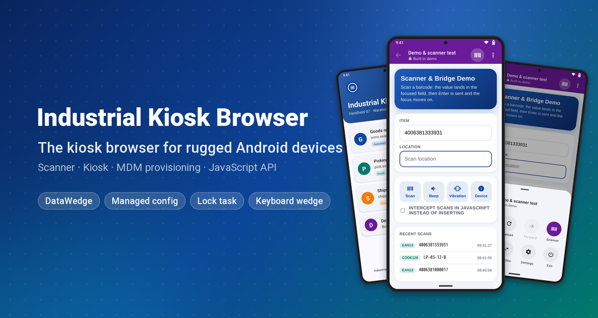
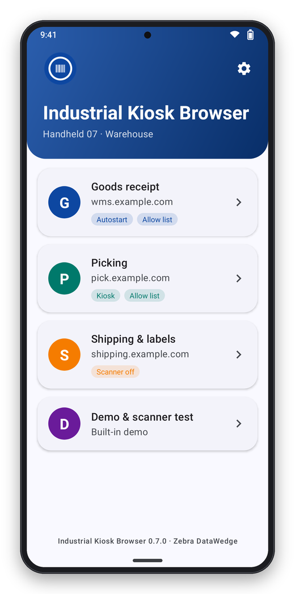
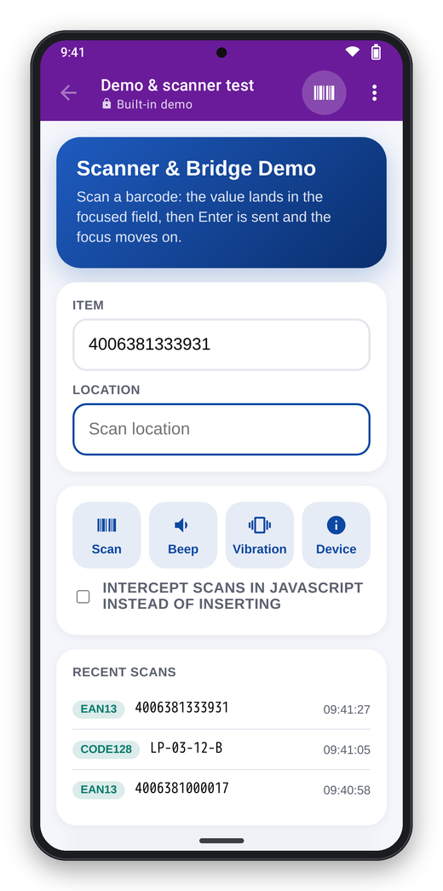
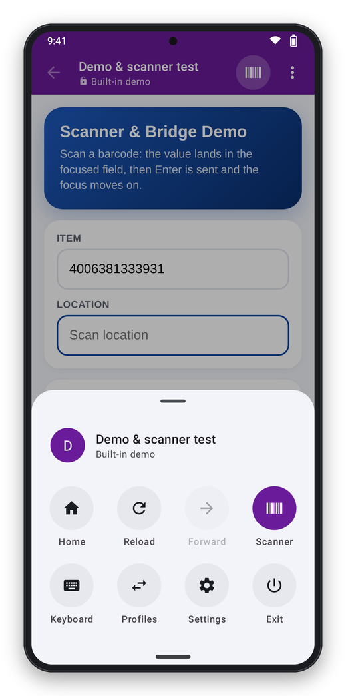
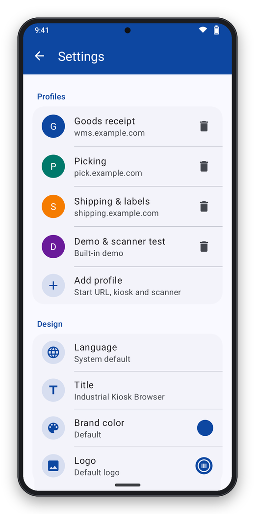
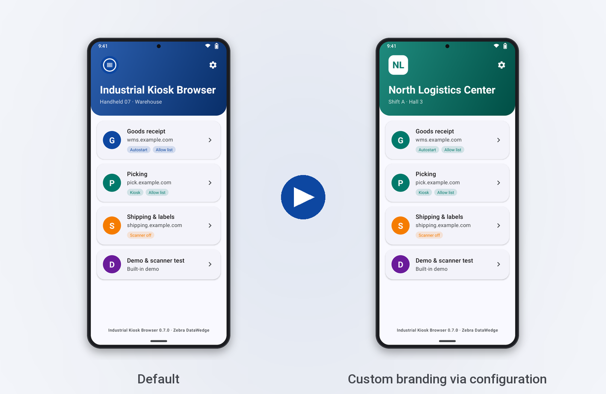
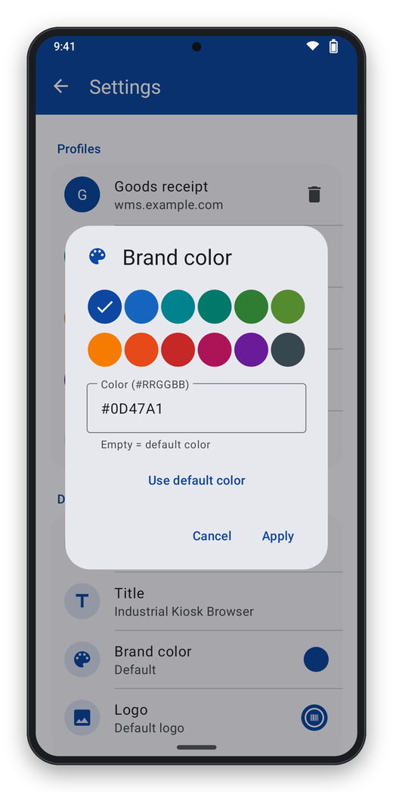
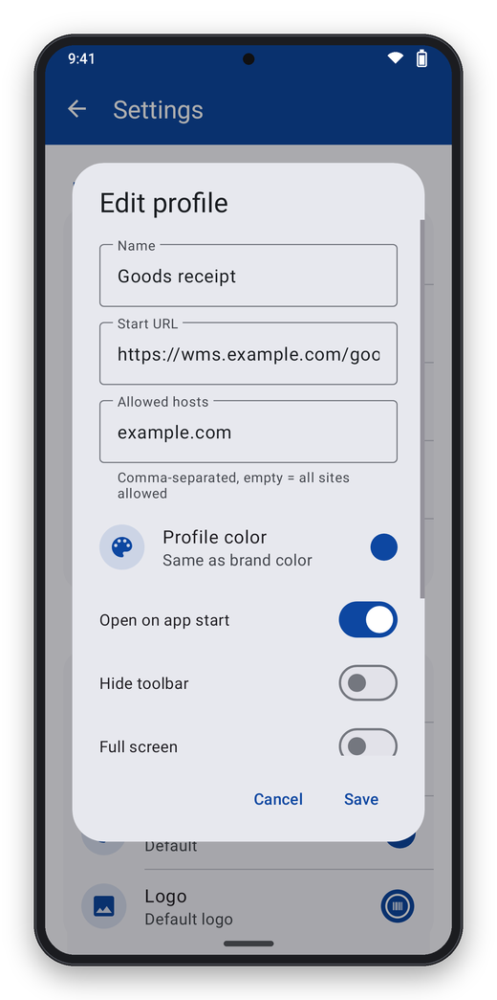
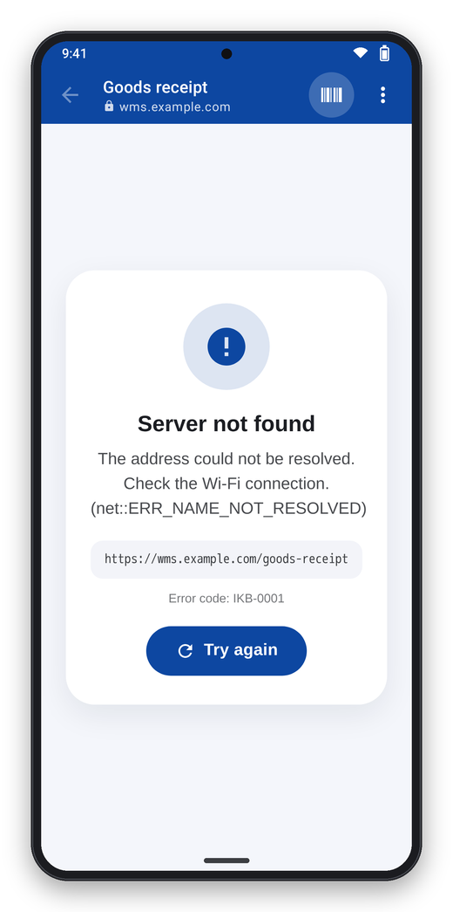
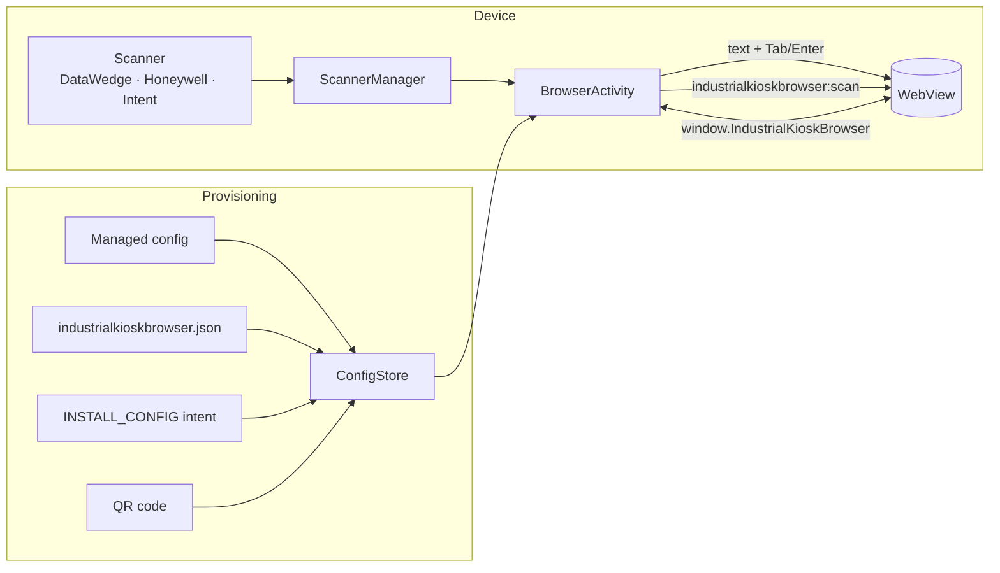

<p align="center">
  
</p>

<p align="center">
  
  <a href="https://github.com/ict-baden/industrialkioskbrowser/releases/latest"></a>
  
  
  <a href="https://github.com/ict-baden/industrialkioskbrowser/actions/workflows/build.yml"></a>
  
  
  
  
</p>

<p align="center">
  <b>Web apps on rugged Android devices – with barcode scanning, kiosk mode and central configuration.</b><br>
  A lean, modern kiosk browser written in Kotlin. Formerly called <i>Pforte</i> and <i>EnterpriseBrowser</i>.
</p>

<p align="center">
  <sub>🇩🇪 Industrial Kiosk Browser bringt Web-Apps auf robuste Android-Geräte (Zebra, Honeywell …): Barcode-Scan direkt ins Webformular,
  Kiosk-Modus, Konfiguration zentral per MDM. Oberfläche auf Deutsch und Englisch; Spanisch, Französisch und Chinesisch sind
  maschinell übersetzt.</sub>
</p>

<p align="center">
  <a href="#-up-and-running-in-5-minutes">Quick start</a> ·
  <a href="docs/configuration.md">Configuration</a> ·
  <a href="docs/deployment.md">Deployment (SOTI, Intune, StageNow)</a> ·
  <a href="docs/web-integration.md">Web integration</a> ·
  <a href="#%EF%B8%8F-limitations">Limitations</a>
</p>

---

## ✨ What it looks like

<table>
  <tr>
    <td align="center"><br><sub><b>Profiles</b><br>One tap opens the web app</sub></td>
    <td align="center"><br><sub><b>Scanning</b><br>Barcode goes into the field + Enter</sub></td>
    <td align="center"><br><sub><b>Menu</b><br>Everything within thumb reach</sub></td>
    <td align="center"><br><sub><b>Settings</b><br>Password protected</sub></td>
  </tr>
</table>

## 🚀 Features

| | |
|---|---|
| 📦 **Profiles** | Start URL, host allow list, user agent, viewport, colors – several web apps on one device |
| 🔫 **Barcode scanning** | Zebra DataWedge, Honeywell, any scanner app via intent. Scans are typed into the focused field like a keyboard (including Tab/Enter) **and** reported as a JavaScript event |
| 🧭 **Page control** | `scanner` and `ScannerNavigate` meta tags control scanning per page |
| ⌨️ **Keyboard** | On-screen keyboard only on demand, hardware key remapping, hotkeys, macros like `{F1}` `{TAB}` |
| 🧩 **Injections** | Add your own CSS/JS/HTML to third-party web apps – matched by URL, without flicker |
| 🔒 **Kiosk** | Hide toolbar/system bars, hide exit or protect it with a password, lock task via device owner |
| 📡 **Provisioning** | Managed configuration (SOTI, Intune, Workspace ONE …), configuration file, StageNow intent, QR code |
| 🎨 **Custom design** | Title, logo, brand color and profile colors – via configuration or right in the app |
| 🛡️ **Security** | Strict TLS checks, client certificates, passwords only stored as PBKDF2 hashes, JavaScript API only for allowed hosts, configuration broadcasts only with the admin password or on EMM-managed devices |

## ⚡ Up and running in 5 minutes

**1. Install the app** – download `IndustrialKioskBrowser-<version>.apk` from the [latest release](../../releases/latest) and distribute it with your MDM, or install it over USB:

```bash
adb install -r IndustrialKioskBrowser-<version>.apk
```

Release APKs are signed by the CI – the current state is under [Limitations](docs/limitations.md#releases-and-updates).

**2. Pick a configuration** – ready-made templates in [`examples/`](examples):

| Template | Use case |
|---|---|
| [`minimal.json`](examples/minimal.json) | One web app that opens automatically |
| [`sap-its-mobile.json`](examples/sap-its-mobile.json) | SAP ITS mobile with Enter after each scan, device-width viewport |
| [`kiosk-single-app.json`](examples/kiosk-single-app.json) | Full kiosk without a way out (change the passwords!) |
| [`multi-profile-branding.json`](examples/multi-profile-branding.json) | Several apps with a custom title and colors |
| [`injections-and-keys.json`](examples/injections-and-keys.json) | CSS/JS injection, key remapping, scan hooks |

**3. Deploy** – for example as a managed configuration in your MDM (key `config_json`) or as a file
(start the app once so the folder exists):

```bash
adb push examples/minimal.json /sdcard/Android/data/de.ictbaden.industrialkioskbrowser/files/industrialkioskbrowser.json
```

All options, including step by step for **SOTI MobiControl**: [Deployment](docs/deployment.md).

**4. Test** – open the built-in profile "Demo & scanner test" and scan, or without a scanner:

```bash
adb shell am broadcast -a de.ictbaden.industrialkioskbrowser.action.BARCODE \
  -p de.ictbaden.industrialkioskbrowser --es data 4006381333931 --es symbology EAN13
```

## 🎨 Custom design

Title, subtitle, logo and brand color come from the configuration – or are set right in the app under
**Settings → Design**. Every profile can also have its own color, which also tints the toolbar inside
the web app.

<p align="center">
  
</p>

```json
"global": {
  "branding": {
    "title": "North Logistics Center",
    "subtitle": "Shift A · Hall 3",
    "color": "#00796B",
    "logo": "res:logo.png"
  }
}
```

<table>
  <tr>
    <td align="center"><br><sub>Pick the brand color in the app</sub></td>
    <td align="center"><br><sub>Profile with its own color</sub></td>
    <td align="center"><br><sub>Clear error pages in the brand color</sub></td>
  </tr>
</table>

More: [Configuration → Custom design](docs/configuration.md#custom-design).

## 🧩 For web developers

```html
<!-- Send Tab instead of Enter after each scan -->
<meta http-equiv="scanner" content="Enable,AutoTab">
```

```js
window.addEventListener('industrialkioskbrowser:scan', (e) => {
  if (e.detail.data.startsWith('LOC-')) {
    e.preventDefault();               // don't type it into the field
    openLocation(e.detail.data);
  }
});
Industrial Kiosk Browser.beep();             // JavaScript API on allowed hosts
```

Everything about events, meta tags and the JavaScript API: [Web integration](docs/web-integration.md).

## 🏗️ Architecture



## ⚠️ Limitations

Honest list in [docs/limitations.md](docs/limitations.md). In short:

- **Zebra scanning uses the DataWedge intent API; the Honeywell integration follows the vendor's documented
  intent API** and still needs to be verified on Honeywell hardware.
- An **empty `allowList` allows every host** – set one on kiosk devices.
- The JavaScript API is also offered to `http://` pages of allowed hosts (intranet apps), and plain HTTP and
  user-installed CAs are accepted – both on purpose for intranets, see the limitations page.
- The user interface is English and German; **Spanish, French and Chinese are machine translations** that
  still need review by native speakers.
- Version 0.x: settings and the JSON format may still change.

## 🛠️ Building

Requirements: JDK 17–21, Android SDK (platform 37).

```bash
./gradlew testDebugUnitTest assembleDebug     # tests + APK
./gradlew recordRoborazziDebug -Pscreenshots  # re-render the documentation screenshots
```

The screenshots in this documentation are rendered straight from the UI code
(Robolectric/Roborazzi, web content with Chromium) – see [`tools/screenshots`](tools/screenshots).

```
app/src/main/java/de/ictbaden/industrialkioskbrowser/
  config/        profile model, JSON format, storage, password hashing
  web/           BrowserActivity, URL policy, scan delivery, JS bridge, keyboard, injections
  scanner/       DataWedge, Honeywell, generic intent
  provisioning/  managed configurations, configuration files, INSTALL_CONFIG
  ui/, admin/    start screen, menu, settings, branding
examples/        ready-made configurations (validated by the tests)
docs/            documentation and images
```

## 📚 Documentation

- [Configuration](docs/configuration.md) – every setting with examples
- [Deployment](docs/deployment.md) – SOTI MobiControl, Intune, Workspace ONE, StageNow, adb, QR
- [Web integration](docs/web-integration.md) – scan events, meta tags, JavaScript API
- [Data and privacy](docs/data-and-privacy.md) – what is stored where, which connections are made
- [Error codes](docs/error-codes.md) – `IKB-0001` … with causes
- [Limitations](docs/limitations.md) – what is tested, what is not, known gaps
- [Security review](docs/security-review.md) – independent reviews of 0.6.x and what was fixed
- [Google Play](docs/play-store.md) – store texts, graphics, Play Console answers
- [Changelog](CHANGELOG.md)

---

<sub>
Industrial Kiosk Browser is free and open source software by <b>ICT-Baden</b>. &nbsp;·&nbsp;
Licence: <a href="LICENSE">MIT</a> &nbsp;·&nbsp;
Third-party licences: <a href="THIRD-PARTY-NOTICES.txt">THIRD-PARTY-NOTICES.txt</a> &nbsp;·&nbsp;
Support: free via GitHub, guaranteed with a <a href="SUPPORT.md">support contract</a> &nbsp;·&nbsp;
<a href="SECURITY.md">Security</a> &nbsp;·&nbsp;
<a href="https://ict-baden.de/datenschutz/industrial-kiosk-browser/">Privacy</a> &nbsp;·&nbsp;
<a href="https://ict-baden.de/impressum/">Impressum</a>
</sub>
