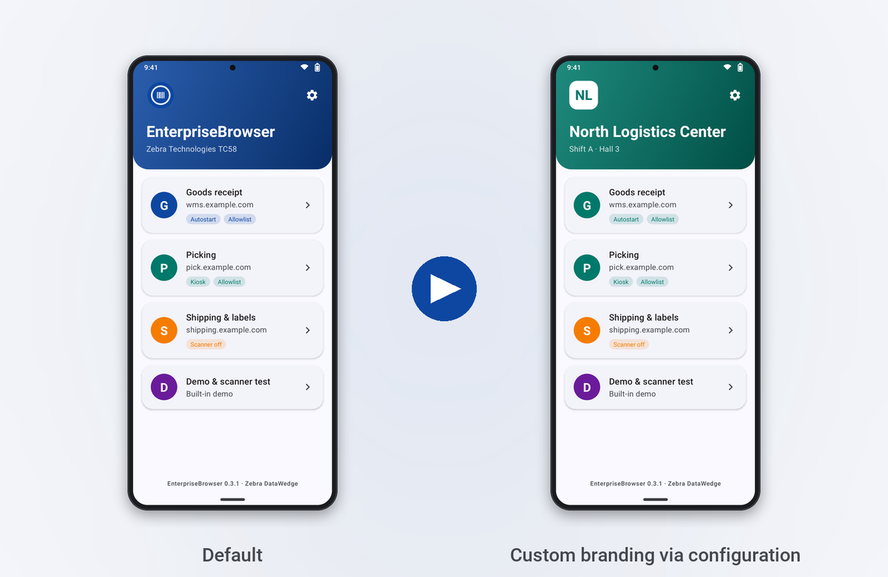
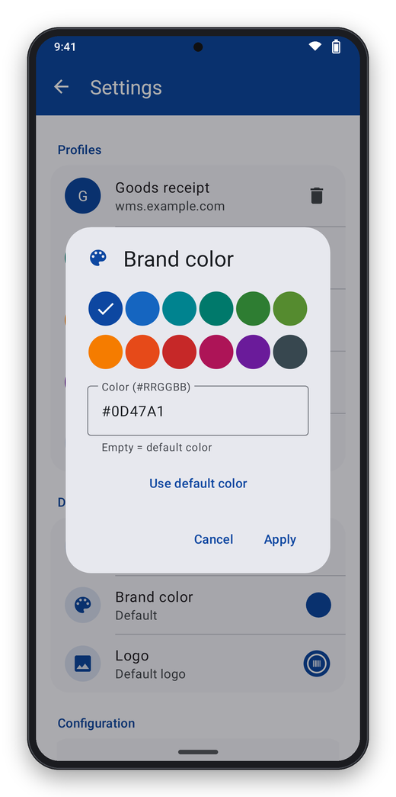
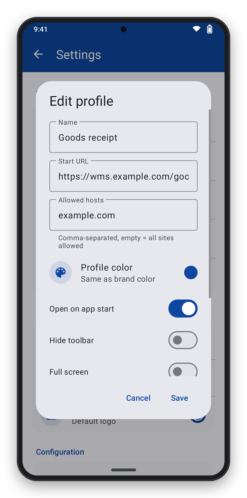

# Configuration

The whole configuration is **one JSON file**. It is distributed through your MDM
([Deployment](deployment.md)), imported/exported in the app under **Settings**, or read
from a QR code. Ready-made templates are in [`examples/`](../examples) – each of them is
checked against the app by the automated tests.

> 💡 Only `startUrl` is required. Everything else has sensible defaults – the minimal
> configuration is [three lines long](../examples/minimal.json).

## Contents

- [Overview](#overview)
- [`global`](#global) – passwords, kiosk, branding
- [Profiles](#profiles) – start URL, allow list, basics
- [`viewport`](#viewport) · [`keyboard`](#keyboard) · [`injections`](#injections) ·
  [`errorPages` and `sounds`](#errorpages-and-sounds) · [`kiosk`](#kiosk) · [`scanner`](#scanner)
- [Resources](#resources)
- [Custom design](#custom-design)

## Overview

```json
{
  "version": 2,
  "global": {
    "adminPassword": "secret",
    "exitPassword": "also-secret",
    "hideExit": false,
    "branding": { "title": "North Logistics Center", "color": "#00796B", "logo": "res:logo.png" }
  },
  "resources": {
    "logo.png": { "base64": "iVBORw0KGgo..." },
    "fix.css":  { "text": "input { min-height: 44px; }" }
  },
  "profiles": [
    {
      "id": "warehouse",
      "name": "Warehouse",
      "startUrl": "https://wms.example.com/",
      "color": "#1565C0",
      "allowList": ["example.com", "sso.example.org"],
      "launchOnStartup": true,
      "userAgent": "{default} WMS-Terminal",
      "clearCacheOnStart": false,
      "clearCookiesOnStart": false,
      "allowFileUpload": false,
      "allowDownloads": true,
      "viewport":   { "mode": "device", "fitToScreen": false, "textZoom": 100, "pinchZoom": true },
      "keyboard":   { "soft": "system", "showOnFocus": false, "hotkeys": { "toggleKeyboard": "F12" } },
      "injections": [ { "match": { "url": "/pick/" }, "css": "res:fix.css" } ],
      "errorPages": { "showHttpErrors": false },
      "sounds":     { "scanOk": "none", "error": "error" },
      "kiosk":      { "hideToolbar": false, "immersive": false, "keepScreenOn": true, "orientation": "auto" },
      "scanner":    { "enabled": true, "terminator": "enter", "injectIntoFocusedField": true }
    }
  ]
}
```

Unknown fields are ignored; invalid values produce a clear error message (import dialog
or **Settings → Last provisioning error**). Every source replaces the whole profile list;
passwords that are not set keep their current value.

## `global`

| Field | Meaning |
|---|---|
| `adminPassword` / `adminPasswordHash` | Protects the settings. Plain text is hashed on import (PBKDF2); exports only contain the hash. |
| `exitPassword` / `exitPasswordHash` | Asked for when exiting. |
| `hideExit` | Hides "Exit" and "Profiles" (kiosk). |
| `branding.title` | Title of the start screen (default: "EnterpriseBrowser") |
| `branding.subtitle` | Subtitle (default: device manufacturer and model) |
| `branding.color` | Brand color `#RRGGBB` for the start screen, toolbars and error pages |
| `branding.logo` | Logo as a resource, e.g. `res:logo.png` (PNG/JPEG/WebP) |

## Profiles

| Field | Default | Meaning |
|---|---|---|
| `id` | from `name` | Unique ID |
| `name` | `startUrl` | Display name |
| `startUrl` | – | **Required**, `http://` or `https://` |
| `color` | brand color | Color of the profile card and toolbar, `#RRGGBB` |
| `allowList` | `[]` | Allowed hosts including subdomains (`example.com` also allows `a.example.com`). Empty = everything allowed. The host of the start URL is always allowed. Applies to main-frame navigations. |
| `launchOnStartup` | `false` | Open this profile directly when the app starts |
| `userAgent` | default | Custom user agent; `{default}` is replaced by the default user agent |
| `clearCacheOnStart`, `clearCookiesOnStart` | `false` | Clear when the profile opens (e.g. a fresh SAP session) |
| `allowFileUpload` | `false` | Allow `<input type="file">` |
| `allowDownloads` | `true` | Downloads through the Android DownloadManager |

## `viewport`

| Field | Default | Meaning |
|---|---|---|
| `mode` | `page` | `page`: the page decides its width (like Chrome). `device`: always the device width. `fixed`: fixed layout width `width`, scaled to the screen. |
| `width` | `0` | Layout width in CSS pixels (only for `fixed`, required) |
| `initialScale` | `0` | Initial zoom in percent, `0` = automatic |
| `fitToScreen` | `true` | Fit pages that are too wide when loading |
| `textZoom` | `100` | Font size in percent (25–400) |
| `pinchZoom` | `true` | Pinch to zoom |
| `metaOverride` | – | Replaces the page's viewport meta tag, e.g. `width=device-width, initial-scale=1` |

> **Tip for classic scanner web apps:** `"viewport": { "mode": "device", "fitToScreen": false }`
> renders at device width without zooming out.
> Version 1 files with `textZoom`/`pinchZoom` directly on the profile are still read.

## `keyboard`

```json
"keyboard": {
  "soft": "system",
  "showOnFocus": false,
  "showOnPageLoad": false,
  "backKey": "{BACK}",
  "remap": [
    { "key": "BUTTON_L1", "send": "{TAB}" },
    { "key": "F5", "send": "{NAVIGATE-REFRESH}" },
    { "key": "VOLUME_UP", "send": "system" },
    { "key": "F7", "send": "" }
  ],
  "hotkeys": { "toggleKeyboard": "F12", "menu": "F11" },
  "longPressDigitsAsF": false
}
```

| Field | Meaning |
|---|---|
| `soft` | `system` (Android keyboard) or `none` (never shown) |
| `showOnFocus` | `false`: the keyboard does not appear when tapping a field, only via the keyboard button in the toolbar or the hotkey |
| `showOnPageLoad` | Show the keyboard after every page load |
| `backKey` | Macro for the back key; `{BACK}` = go back or open the menu |
| `remap` | Hardware key (`key`: Android name without `KEYCODE_`, e.g. `F1`, `BUTTON_L1`, `ENTER`, or a number) → macro. `system` passes the key through, empty swallows it. |
| `hotkeys` | Action → key. Actions: `toggleKeyboard`, `menu`, `home`, `reload`, `back`, `forward`, `scan` |
| `longPressDigitsAsF` | Long press on 1–9/0 sends F1–F10 |

**Macros** (case-insensitive): plain text is typed,
`{TAB}`, `{BACK-TAB}`, `{ENTER}`, `{ESC}`, `{BS}`, `{DELETE}`, `{INSERT}`, `{HOME}`,
`{END}`, `{PAGE-UP}`, `{PAGE-DOWN}`, `{UP}` `{DOWN}` `{LEFT}` `{RIGHT}`, `{SPACE}`,
`{F1}`–`{F12}`, `{CTRL-C}`, `{HEX:00E4}`, `{OPEN-BRACE}`/`{CLOSE-BRACE}`,
`{PAUSE}` / `{PAUSE:500}`, actions `{BACK}`, `{NAVIGATE-BACK}`,
`{NAVIGATE-FORWARD}`, `{NAVIGATE-STOP}`, `{NAVIGATE-HOME}`, `{NAVIGATE-REFRESH}`,
`{SPECIAL:SCAN}`, `{MENU}`, `{KEYBOARD}`. Unknown tokens are typed as text.

## `injections`

Add your own CSS, JavaScript or HTML to pages – for example larger input fields for a
third-party web app, or a scan hook.

```json
"injections": [
  { "match": { "url": "/sap/bc/gui/sap/its/", "type": "contains" }, "when": "documentStart", "css": "res:sap.css" },
  { "match": { "url": "^https://wms\\.example\\.com/pick", "type": "regex", "source": "id=\"pickForm\"" },
    "when": "pageLoaded", "js": "res:pick.js", "frames": "main" },
  { "html": "<div class='banner'>TEST SYSTEM</div>", "position": "bodyStart" }
]
```

| Field | Meaning |
|---|---|
| `match.url` / `match.type` | `contains` (default), `prefix`, `regex`; without `url` the injection applies to every page |
| `match.source` | Only inject if the page source contains this text |
| `when` | `documentStart` (before first render, no flicker – default) or `pageLoaded` |
| `frames` | `main` (default) or `all` (only with `documentStart`) |
| `css` / `js` / `html` | Inline content or `res:<name>`; `<script>` inside HTML is executed |
| `position` | For HTML: `bodyEnd` (default), `bodyStart`, `head` |

## `errorPages` and `sounds`

```json
"errorPages": { "template": "res:error.html", "showHttpErrors": false },
"sounds": { "scanOk": "none", "error": "tone:1400:200:1000:200" }
```

- `template` – your own HTML with the placeholders `{{title}}`, `{{message}}`, `{{url}}`
  and `{{color}}` (brand color). The link `ebrowser://retry` reloads. Without a template
  the built-in error page is used (see [image](images/screen-error.png)).
- `showHttpErrors` – also replaces the server's error pages (HTTP ≥ 400).
- Sounds: `none`, `beep`, `error`, `tone:<Hz>:<ms>[:<Hz>:<ms>…]` or `res:<name>`
  (audio file). `error` plays on error pages and blocked pages.

## `kiosk`

| Field | Default | Meaning |
|---|---|---|
| `hideToolbar` | `false` | Hide the toolbar (menu then via the back key or the hotkey) |
| `immersive` | `false` | Hide status and navigation bars |
| `keepScreenOn` | `true` | Keep the display on |
| `orientation` | `auto` | `auto`, `portrait`, `landscape` |

For a full kiosk also set `global.hideExit` and allow the app for **lock task** in your
MDM (dedicated device) – it then starts locked automatically.
Template: [`kiosk-single-app.json`](../examples/kiosk-single-app.json).

## `scanner`

| Field | Default | Meaning |
|---|---|---|
| `enabled` | `true` | Scanner active when a page loads |
| `terminator` | `enter` | Keys sent after inserting: `none`, `tab`, `enter`, `tab+enter`, `enter+tab` |
| `injectIntoFocusedField` | `true` | Type the scan into the focused input field |

| Device | Integration |
|---|---|
| Zebra | DataWedge intent API. On start a DataWedge profile "EnterpriseBrowser" is created (intent output on, keystroke off). Decoder settings are left alone and can be tuned in DataWedge/StageNow. |
| Honeywell | Intent API of the Data Collection Service (the scanner is claimed with data intent output). |
| Others | Any scanner app that broadcasts `io.github.pieewiee.enterprisebrowser.action.BARCODE` with the barcode in an extra (`data`, `…data_string`, `…decode_string`, `barcode_string`). |

Pages can control the scanner with meta tags – see [Web integration](web-integration.md).

## Resources

```json
"resources": {
  "sap.css":  { "text": "input { min-height: 44px; font-size: 18px; }" },
  "logo.png": { "base64": "iVBORw0KGgo..." }
}
```

Resources are shared by all profiles. They are referenced as `res:<name>` and available to
pages at `https://appassets.androidplatform.net/res/<name>` (e.g. images in injected CSS).
Names may contain folders (`css/a.css`), but no `..`.

## Custom design



Three levels:

1. **Branding** (`global.branding`) – title, subtitle, logo and brand color of the start
   screen; the color also applies to the settings and error pages.
2. **Profile color** (`profiles[].color`) – tints the profile card, toolbar and menu of
   that web app, so people can see at a glance where they are.
3. **Injections** – fine-tuning of the web app itself (font sizes, buttons, banners).

Without an MDM the design can also be set right on the device: **Settings → Design**
(title, brand color from a palette or as a hex value, logo from an image file). Text and
icon colors adapt automatically – even light brand colors stay readable.

<p>
  
  
</p>
