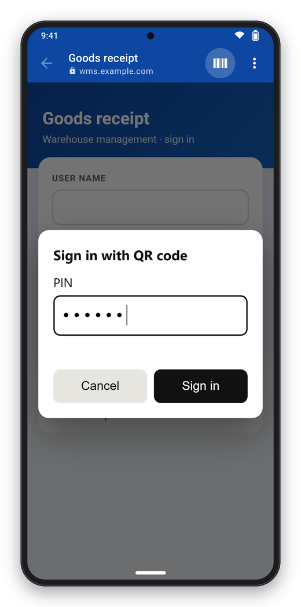
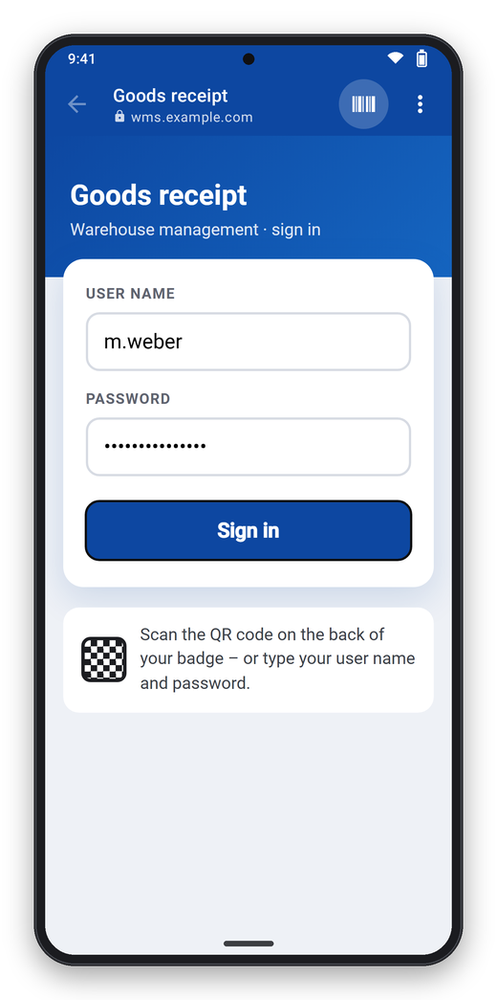

# QR login

Sign in to a web app by scanning a QR code and entering a short PIN, instead of typing user name and password on the
handheld. The QR code holds both, encrypted with the PIN. This works with every web app that has a normal sign-in form
and needs no change to the app – only a JavaScript [injection](configuration.md#injections) in the kiosk profile.

Everything here is an example you can use and adapt: the script `examples/qr-login/qr-login.js`, the configuration
`examples/qr-login.json` and the generator at <https://ict-baden.de/werkzeuge/qr-login/> (English:
<https://ict-baden.de/en/tools/qr-login/>).

## How it works

<p align="center">
  
  
</p>

1. An administrator (or the user) opens the generator, enters user name, password and a PIN, optionally an expiry date,
   and prints the QR code – for example on the back of the badge. The generator runs in the browser only; nothing is
   sent anywhere.
2. On the handheld the login page is open in Industrial Kiosk Browser. The user scans the QR code.
3. The injected script takes the scan out of the page (`preventDefault()` on the
   [scan event](web-integration.md#scan-event)), so the encrypted text is never typed into a field, and asks for the PIN.
4. With the right PIN it decrypts the code, fills user name and password into the form and presses its sign-in button.
   A wrong PIN is refused; after five wrong PINs in a row the script ignores login codes for 15 minutes.

## Format

```
IKBL1.<base64url of: 0x01 | iterations (uint32, big-endian) | salt (16 bytes) | IV (12 bytes) | ciphertext + GCM tag>
```

- AES-256-GCM, additional data `IKBL1`; the key comes from the PIN with PBKDF2-SHA256, 600,000 iterations by default
  (the number is stored in the code).
- Plain text: UTF-8 JSON `{ "u": "<user>", "p": "<password>", "x": <expiry in Unix seconds, 0 = none> }`.
- A code is about 130–200 characters, a QR code of version 7–9 – fine for every scan engine and for the camera scanner.
  The scan engine has to read QR codes (DataWedge: decoder *QR Code* on, which is the default).

`tools/qr-login/test.mjs` checks that the generator and the script agree (`node tools/qr-login/test.mjs`).

## Setting it up

1. Create a QR code with the generator and keep the PIN apart from it.
2. Add the script to the profile of the web app. The example configuration `examples/qr-login.json` carries it as a
   resource; the injection runs on the login page only:

   ```json
   "injections": [
     { "match": { "url": "https://login.example.com/", "type": "prefix" }, "when": "pageLoaded", "js": "res:qr-login.js" }
   ]
   ```

3. If the script does not find the fields itself, name them in an injection before it:

   ```json
   { "match": { "url": "https://login.example.com/", "type": "prefix" }, "when": "pageLoaded",
     "js": "window.IKB_QR_LOGIN = { user: '#j_username', password: '#j_password', submit: true };" }
   ```

   Settings: `user` and `password` (CSS selectors; without them the script looks for usual names such as `username`,
   `type="email"` and the first password field), `submit` (press the sign-in button, default `true`), `maxTries`
   (default 5) and `lockMinutes` (default 15).
4. Test on a device: open the login page, scan the code, tap the PIN field if the keyboard does not open by itself,
   enter the PIN.

## Requirements and limits

- **The login page must be https.** The script uses WebCrypto, which browsers offer only to secure pages
  (`https://`, or `http://localhost`). On an `http://` page the script shows “QR login needs an https page” and does
  nothing else.
- The script fills the first matching fields and presses the form's sign-in button. Sign-in pages that are built
  differently (several steps, user name on one page and password on the next, a button outside the form) need
  their own selectors, or a small change in the script.
- Single sign-on with a second factor (app, SMS) is not replaced; the QR code only types user name and password.

## Security – what the PIN does and does not do

**Whoever has the QR code and the PIN can sign in.** Treat the code like a key.

The PIN protects a lost or found code against a quick try on a device: the script allows five wrong PINs, then
waits 15 minutes. That limit lives in the page (local storage of the WebView), so it is a speed bump, not a lock.

Against someone who **copies the QR code** (a photo is enough) the PIN alone helps little: the attacker can try PINs
on their own computer, without any limit. PBKDF2 with 600,000 iterations makes each try slow, but a current graphics
card still manages roughly 15,000 tries per second:

| PIN | Possibilities | Time to try all, one graphics card (approx.) |
|---|---|---|
| 4 digits | 10,000 | under a second |
| 6 digits | 1,000,000 | about a minute |
| 8 digits | 100 million | about 2 hours |
| 10 characters, letters and digits | about 8 × 10¹⁷ | far longer than any password lifetime |

So:

- Use the QR login for accounts whose password you would also write on a card: personal accounts with only the rights
  needed on the handheld, not administrator accounts.
- Use a longer PIN where codes can be copied (letters and digits, 10 characters or more – the generator shows the
  estimate). On the handheld the user types it once per sign-in.
- Set an expiry date, and create new codes when passwords change – an old code then simply stops working.
- When a code is lost, change the password of that account.

A stronger variant would bind the codes to your devices (a key only the managed devices hold, given by the MDM), so a
copied code is worthless without such a device. That needs decryption inside the app and is not part of this example.
