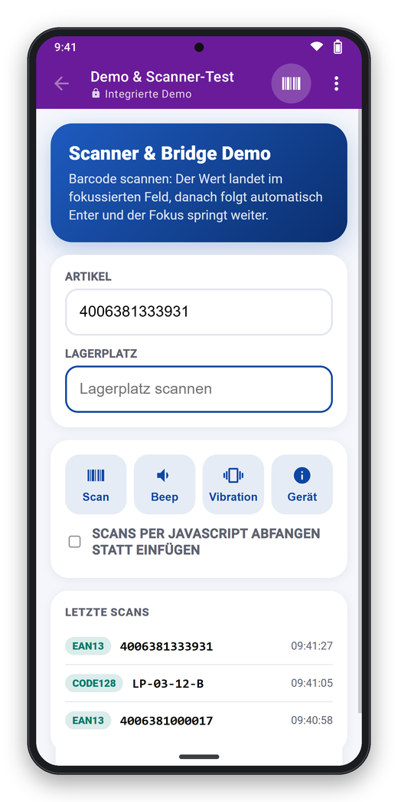
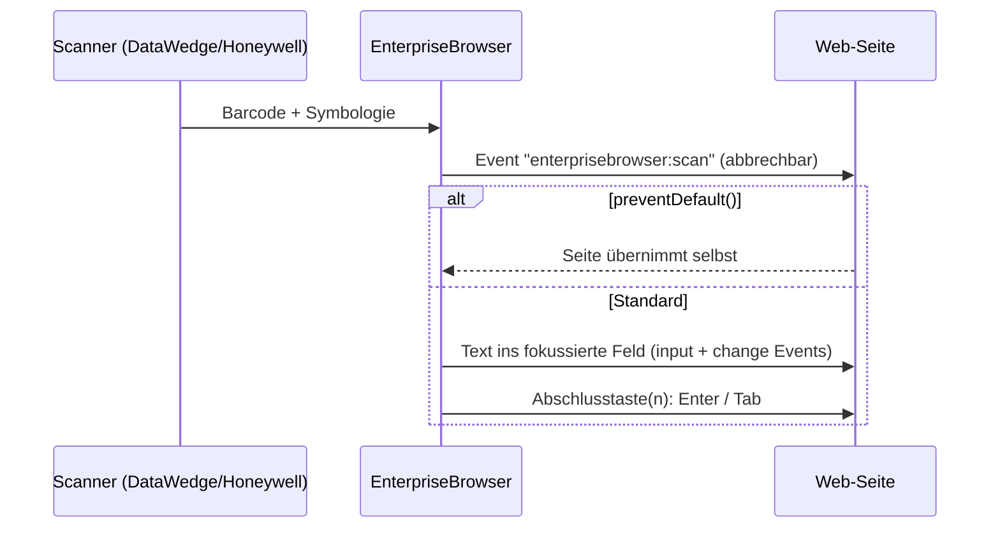

# Web-Integration

Für Entwickler der Web-Anwendungen, die im EnterpriseBrowser laufen. Eine bestehende
Web-App funktioniert **ohne Anpassung**: Scans werden wie Tastatureingaben ins
fokussierte Feld geschrieben. Alles hier ist optional.

<p align="center"></p>

## Was bei einem Scan passiert



1. Gibt es auf der Seite ein `ScannerNavigate`-Meta-Tag, wird stattdessen dessen Ziel
   aufgerufen (siehe unten) – sonst:
2. Auf `window` wird das abbrechbare Event `enterprisebrowser:scan` ausgelöst.
3. Ruft kein Listener `preventDefault()` auf, wird der Text in das fokussierte
   Eingabefeld geschrieben (auch in Shadow DOM und gleich-originigen iframes). Dabei
   feuern `input`- und `change`-Events – React, Vue & Co. bekommen den Wert mit.
4. Danach folgen die Abschlusstasten (`scanner.terminator`, Standard: Enter) als echte
   Tastendrücke – Formulare werden also abgeschickt wie bei einem Keyboard-Wedge.

## Scan-Event

```js
window.addEventListener('enterprisebrowser:scan', (event) => {
  const { data, symbology, source, timestamp } = event.detail;
  // data: "4006381333931", symbology: "EAN13", source: "Zebra DataWedge"
  if (data.startsWith('LOC-')) {
    event.preventDefault();                 // nicht ins Feld schreiben, keine Abschlusstaste
    location.href = '/location/' + encodeURIComponent(data);
  }
});
```

Das Event kommt auf jeder Seite an – auch ohne JavaScript-API-Freigabe.

## Meta-Tags

Velocity-kompatibel, gelten für die aktuelle Seite:

```html
<meta http-equiv="scanner" content="Disable">              <!-- Scanner auf dieser Seite aus -->
<meta http-equiv="scanner" content="Enable,AutoTab">       <!-- an, nach Scan Tab senden -->
<meta http-equiv="scanner" content="NoAuto">               <!-- keine Abschlusstaste -->
<meta http-equiv="ScannerNavigate" content="https://wms.example.com/item?code=%s">
<meta http-equiv="ScannerNavigate" content="javascript:lookup(%s)">
```

- `scanner` kombiniert `Enable`/`Resume`, `Disable`/`Suspend`, `AutoTab`, `AutoEnter`,
  `AutoTabAndEnter`, `AutoEnterAndTab`, `NoAuto` (durch Komma getrennt).
- `ScannerNavigate`: `%s` wird bei URLs URL-kodiert, bei `javascript:` als
  JavaScript-String eingesetzt (inkl. Anführungszeichen). Der Scan landet dann nicht im Feld.
- `name="…"` funktioniert genauso wie `http-equiv="…"`.

## JavaScript-API

Auf freigegebenen Hosts steht `window.EnterpriseBrowser` zur Verfügung – freigegeben
sind die Hosts der `allowList` bzw. ohne Allowlist der Host der Start-URL. Alle
Methoden liefern Promises.

```js
EnterpriseBrowser.onScan((scan, event) => { /* wie das Scan-Event */ });

await EnterpriseBrowser.scanner.trigger();       // Scan auslösen (Softtrigger)
await EnterpriseBrowser.scanner.trigger(false);  // Scan stoppen
await EnterpriseBrowser.scanner.disable();       // Scanner aus – bis zum nächsten Seitenwechsel
await EnterpriseBrowser.scanner.enable();
const { name, enabled } = await EnterpriseBrowser.scanner.status();

await EnterpriseBrowser.beep();                  // Bestätigung
await EnterpriseBrowser.beep('error');           // Fehlerton
await EnterpriseBrowser.vibrate(300);
await EnterpriseBrowser.toast('Gebucht');

const info = await EnterpriseBrowser.deviceInfo();
// { manufacturer, model, androidVersion, sdk, appVersion, profileId, scanner }
```

Feature-Erkennung für Seiten, die auch im normalen Browser laufen:

```js
if (window.EnterpriseBrowser) {
  EnterpriseBrowser.beep();
}
```

> **Hinweis:** Auf Servern mit Nicht-Standard-Port (z. B. `:9001`) ist
> `window.EnterpriseBrowser` derzeit nicht verfügbar. Scans, Scan-Event und Meta-Tags
> funktionieren dort trotzdem.

## Eingebaute Seiten und Ressourcen

| URL | Inhalt |
|---|---|
| `https://appassets.androidplatform.net/assets/demo/index.html` | Demo- und Testseite für Scanner und API |
| `https://appassets.androidplatform.net/res/<name>` | Ressourcen aus der Konfiguration (`resources`) |

## Testen ohne Scanner

```bash
adb shell am broadcast -a io.github.pieewiee.enterprisebrowser.action.BARCODE \
  -p io.github.pieewiee.enterprisebrowser --es data 4006381333931 --es symbology EAN13
```

Remote-Debugging mit Chrome DevTools (`chrome://inspect`) ist in Debug-Builds aktiv.
