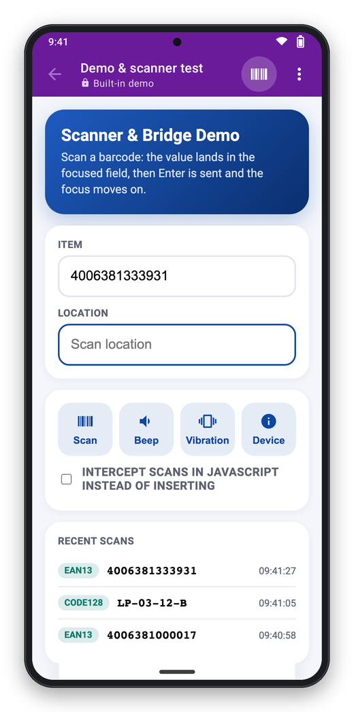
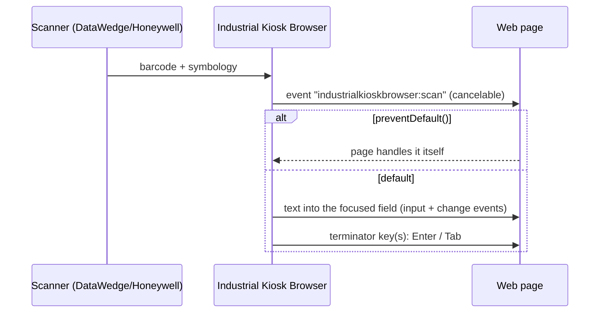

# Web integration

For developers of the web apps that run in IndustrialKioskBrowser. An existing web app works
**without any changes**: scans are typed into the focused field like keyboard input.
Everything on this page is optional.

<p align="center"></p>

## What happens on a scan



While the page is loading, is sending a form or reports itself busy, the scan first waits in the
[scan queue](#scan-queue); the steps below run once the page is ready.

1. If the page has a `ScannerNavigate` meta tag, its target is opened instead (see
   below) – otherwise:
2. The cancelable event `industrialkioskbrowser:scan` is dispatched on `window`.
3. Unless a listener calls `preventDefault()`, the text is written into the focused input
   field (also inside shadow DOM and same-origin iframes). `input` and `change` events are
   fired – React, Vue & co. pick up the value.
4. Then the terminator keys follow (`scanner.terminator`, default: Enter) as real key
   presses – so forms are submitted just like with a keyboard wedge.

The focused field can be of any type, **including `type="password"`** (sign-in with a badge
barcode). To keep scans out of password fields, cancel the event there:

```js
window.addEventListener('industrialkioskbrowser:scan', (event) => {
  if (document.activeElement?.type === 'password') event.preventDefault();
});
```

## Scan event

```js
window.addEventListener('industrialkioskbrowser:scan', (event) => {
  const { data, symbology, source, timestamp } = event.detail;
  // data: "4006381333931", symbology: "EAN13", source: "Zebra DataWedge"
  // source is "Camera" for the camera scanner, "ocr" (symbology "ocr") for recognised text and
  // "nfc" (symbology "nfc") for NFC tags
  if (data.startsWith('LOC-')) {
    event.preventDefault();                 // don't type it, no terminator key
    location.href = '/location/' + encodeURIComponent(data);
  }
});
```

The event is dispatched on every page – even without JavaScript API access.

## Meta tags

They apply to the current page:

```html
<meta http-equiv="scanner" content="Disable">              <!-- scanner off on this page -->
<meta http-equiv="scanner" content="Enable,AutoTab">       <!-- on, send Tab after each scan -->
<meta http-equiv="scanner" content="NoAuto">               <!-- no terminator key -->
<meta http-equiv="ScannerNavigate" content="https://wms.example.com/item?code=%s">
<meta http-equiv="ScannerNavigate" content="javascript:lookup(%s)">
```

- `scanner` combines `Enable`/`Resume`, `Disable`/`Suspend`, `AutoTab`, `AutoEnter`,
  `AutoTabAndEnter`, `AutoEnterAndTab`, `NoAuto` (comma-separated).
- `ScannerNavigate`: relative targets (`/item?code=%s`) are resolved against the current page; the allow list applies. `%s` is URL-encoded for URLs and inserted as a JavaScript string
  (including quotes) for `javascript:`. The scan is then not typed into a field.
- `name="…"` works the same as `http-equiv="…"`.

## JavaScript API

`window.IndustrialKioskBrowser` is available on allowed hosts – the hosts of the `allowList`
(with the scheme and port of an entry that names them, see
[`allowList` entries](configuration.md#allowlist-entries)), or the host of the start URL when
there is no allow list. On a port other than 80 (`http`) or 443 (`https`) the API needs the port to be
named: the start URL's own port is covered, other ports need an `allowList` entry with the port
(`wms.example.com:8080`). All methods return promises.

```js
IndustrialKioskBrowser.onScan((scan, event) => { /* same as the scan event */ });

await IndustrialKioskBrowser.scanner.trigger();       // start scanning (soft trigger)
await IndustrialKioskBrowser.scanner.trigger(false);  // stop scanning
await IndustrialKioskBrowser.scanner.trigger({ mode: "text" }); // text recognition (OCR) with the camera
await IndustrialKioskBrowser.scanner.disable();       // scanner off until the next page load
await IndustrialKioskBrowser.scanner.enable();
const { name, enabled, pending, ready } = await IndustrialKioskBrowser.scanner.status();
// pending: scans waiting in the queue, ready: a new scan would be delivered right away
await IndustrialKioskBrowser.scanner.busy();          // hold scans back while the page works …
await IndustrialKioskBrowser.scanner.ready();         // … and let them through again

await IndustrialKioskBrowser.beep();                  // confirmation
await IndustrialKioskBrowser.beep('error');           // error tone
await IndustrialKioskBrowser.vibrate(300);
await IndustrialKioskBrowser.toast('Booked');

const info = await IndustrialKioskBrowser.deviceInfo();
// { manufacturer, model, androidVersion, sdk, appVersion, profileId, scanner }
```

Feature detection for pages that also run in a normal browser:

```js
if (window.IndustrialKioskBrowser) {
  IndustrialKioskBrowser.beep();
}
```

> **Note:** on a non-default port (e.g. `:8443`) `window.IndustrialKioskBrowser` is available for
> the start URL of the profile and for `allowList` entries that name the port (`example.com:8443`).
> An entry without a port only covers ports 80 and 443 for the API. Scans, the scan event and the
> meta tags work on every allowed address.

## Scan queue

Scans that arrive while the page cannot take them wait in the app and are delivered one by one
afterwards, each with its terminator key ([`scanner.queue`](configuration.md#scannerqueue)). The
app sees by itself when a page loads and when a form sent with Enter navigates. What it cannot see
is work the page does in JavaScript – saving with `fetch()`, then showing the next step without a
new page. For that the page says so:

```js
const form = document.querySelector('#receipt');
form.addEventListener('submit', async (event) => {
  event.preventDefault();
  const api = window.IndustrialKioskBrowser;
  api?.scanner.busy();                       // scans now wait in the app
  try {
    await fetch('/api/receipt', { method: 'POST', body: new FormData(form) });
    form.reset();
    form.querySelector('input[name=item]').focus();
  } finally {
    api?.scanner.ready();                    // the next scan goes into the empty field
  }
});
```

- `busy(timeoutMs)` holds scans back until `ready()`, at most `timeoutMs` (default
  `scanner.queue.timeoutMs`, 15 s) in case `ready()` never comes. Loading a new page ends it too.
- Calling `busy()` inside the scan event handler or an `input`/`change` handler holds back the
  very next scan already – the app checks this when the handler returns.
- A scan handled with `preventDefault()` starts no wait of its own; call `busy()` when the handling
  takes time.
- Without the JavaScript API (other hosts, a port the allow list does not name) the queue still waits for page loads
  and sent forms; only `busy()` is missing.
- A scan that finds no focused field waits until one has the focus. Pages that handle the scan
  event without a field should call `preventDefault()`, otherwise the scan waits for a field and is
  discarded after `timeoutMs` with `IKB-0041`.
- After a scan with terminator key the next scan also waits while the field still holds that scan
  (`scanner.queue.waitForFieldClear`) – empty the field when the save is done, as above. A page
  that keeps the value on purpose and wants scans appended turns `waitForFieldClear` off; one that
  selects the whole text after sending gets it replaced by the next scan.

## Built-in pages and resources

| URL | Content |
|---|---|
| `https://appassets.androidplatform.net/assets/demo/index.html` | Demo and test page for the scanner and the API |
| `https://appassets.androidplatform.net/res/<name>` | Resources from the configuration (`resources`) |

## Testing without a scanner

```bash
adb shell am broadcast -a de.ictbaden.industrialkioskbrowser.action.BARCODE \
  -p de.ictbaden.industrialkioskbrowser --es data 4006381333931 --es symbology EAN13
```

Remote debugging with Chrome DevTools (`chrome://inspect`) is enabled in debug builds.
