# Web integration

For developers of the web apps that run in Industrial Kiosk Browser. An existing web app works
**without any changes**: scans are typed into the focused field like keyboard input.
Everything on this page is optional.

<p align="center"></p>

## What happens on a scan

```mermaid
sequenceDiagram
  participant S as Scanner (DataWedge/Honeywell)
  participant A as Industrial Kiosk Browser
  participant P as Web page
  S->>A: barcode + symbology
  A->>P: event "industrialkioskbrowser:scan" (cancelable)
  alt preventDefault()
    P-->>A: page handles it itself
  else default
    A->>P: text into the focused field (input + change events)
    A->>P: terminator key(s): Enter / Tab
  end
```



1. If the page has a `ScannerNavigate` meta tag, its target is opened instead (see
   below) – otherwise:
2. The cancelable event `industrialkioskbrowser:scan` is dispatched on `window`.
3. Unless a listener calls `preventDefault()`, the text is written into the focused input
   field (also inside shadow DOM and same-origin iframes). `input` and `change` events are
   fired – React, Vue & co. pick up the value.
4. Then the terminator keys follow (`scanner.terminator`, default: Enter) as real key
   presses – so forms are submitted just like with a keyboard wedge.

## Scan event

```js
window.addEventListener('industrialkioskbrowser:scan', (event) => {
  const { data, symbology, source, timestamp } = event.detail;
  // data: "4006381333931", symbology: "EAN13", source: "Zebra DataWedge"
  if (data.startsWith('LOC-')) {
    event.preventDefault();                 // don't type it, no terminator key
    location.href = '/location/' + encodeURIComponent(data);
  }
});
```

The event is dispatched on every page – even without JavaScript API access.

## Meta tags

They apply to the current page:

```html
<meta http-equiv="scanner" content="Disable">              <!-- scanner off on this page -->
<meta http-equiv="scanner" content="Enable,AutoTab">       <!-- on, send Tab after each scan -->
<meta http-equiv="scanner" content="NoAuto">               <!-- no terminator key -->
<meta http-equiv="ScannerNavigate" content="https://wms.example.com/item?code=%s">
<meta http-equiv="ScannerNavigate" content="javascript:lookup(%s)">
```

- `scanner` combines `Enable`/`Resume`, `Disable`/`Suspend`, `AutoTab`, `AutoEnter`,
  `AutoTabAndEnter`, `AutoEnterAndTab`, `NoAuto` (comma-separated).
- `ScannerNavigate`: relative targets (`/item?code=%s`) are resolved against the current page; the allow list applies. `%s` is URL-encoded for URLs and inserted as a JavaScript string
  (including quotes) for `javascript:`. The scan is then not typed into a field.
- `name="…"` works the same as `http-equiv="…"`.

## JavaScript API

`window.IndustrialKioskBrowser` is available on allowed hosts – the hosts of the `allowList`,
or the host of the start URL when there is no allow list. All methods return promises.

```js
IndustrialKioskBrowser.onScan((scan, event) => { /* same as the scan event */ });

await Industrial Kiosk Browser.scanner.trigger();       // start scanning (soft trigger)
await Industrial Kiosk Browser.scanner.trigger(false);  // stop scanning
await Industrial Kiosk Browser.scanner.disable();       // scanner off until the next page load
await Industrial Kiosk Browser.scanner.enable();
const { name, enabled } = await Industrial Kiosk Browser.scanner.status();

await Industrial Kiosk Browser.beep();                  // confirmation
await Industrial Kiosk Browser.beep('error');           // error tone
await Industrial Kiosk Browser.vibrate(300);
await Industrial Kiosk Browser.toast('Booked');

const info = await Industrial Kiosk Browser.deviceInfo();
// { manufacturer, model, androidVersion, sdk, appVersion, profileId, scanner }
```

Feature detection for pages that also run in a normal browser:

```js
if (window.IndustrialKioskBrowser) {
  Industrial Kiosk Browser.beep();
}
```

> **Note:** on servers with a non-default port (e.g. `:8443`)
> `window.IndustrialKioskBrowser` is currently not available. Scans, the scan event and the
> meta tags still work there.

## Built-in pages and resources

| URL | Content |
|---|---|
| `https://appassets.androidplatform.net/assets/demo/index.html` | Demo and test page for the scanner and the API |
| `https://appassets.androidplatform.net/res/<name>` | Resources from the configuration (`resources`) |

## Testing without a scanner

```bash
adb shell am broadcast -a de.ictbaden.industrialkioskbrowser.action.BARCODE \
  -p de.ictbaden.industrialkioskbrowser --es data 4006381333931 --es symbology EAN13
```

Remote debugging with Chrome DevTools (`chrome://inspect`) is enabled in debug builds.
